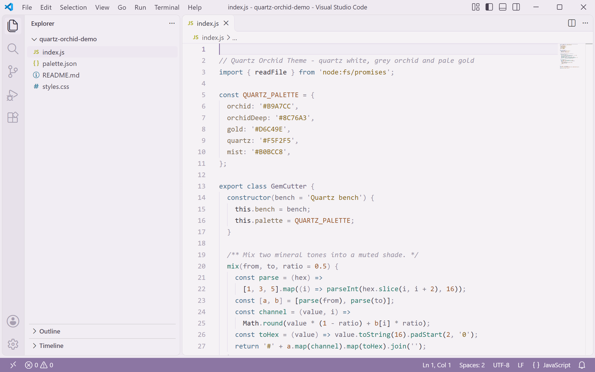
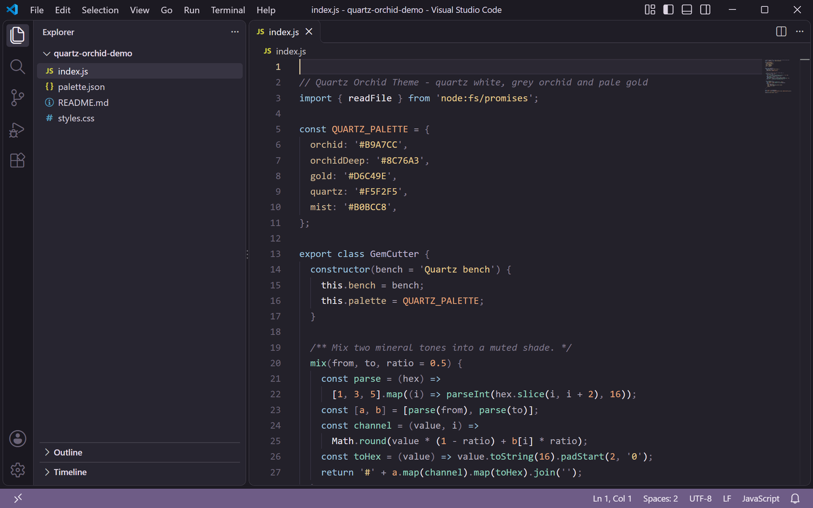

<p align="center">
  
</p>

<h1 align="center">Quartz Orchid Theme</h1>

<p align="center">
  <a href="https://marketplace.visualstudio.com/items?itemName=lilinhuang.quartz-orchid-theme"></a>
  
  
  <a href="https://github.com/vaxicy/quartz-orchid-theme/blob/master/LICENSE"></a>
</p>

A quiet mineral theme: **quartz white with grey orchid and pale gold** in the light variant, and a **warm ink room with muted lilac accents** in the dark one. Both variants share one palette, so switching changes the light, not the stone.

一套安静的矿石配色主题：浅色版是**石英白底**配灰丁香与淡金，深色版是**暖灰墨底**配雾化丁香点缀。明暗两版共用同一套色板，切换时变的是光线，不是石头。

## Preview / 预览

| Light 浅色 | Dark 深色 |
| --- | --- |
|  |  |

> Both previews are captured from a real VS Code window running the theme — no mockups.
>
> 上方预览图取自真实运行该主题的 VS Code 窗口截图，非模拟图。

## Palette / 色板

| Role | Light | Dark |
| --- | --- | --- |
| Editor background | `#F5F2F5` quartz white | `#23212A` warm ink |
| Foreground | `#3A3440` graphite violet | `#E9E3EC` pale lilac |
| Muted text / placeholders | `#8B8494` | `#9A93A6` |
| Side bar | `#F1EDF3` with `#4A4350` text | `#272530` with `#D5CEDC` text |
| Panel / terminal | `#F4F1F5` | `#201E27` |
| Title bar | `#EFEAF1` with `#48414F` text | `#1C1A22` with `#DCD5E2` text |
| Tab bar / inactive tab | `#EFEBF1` | `#1F1D26` |
| Active tab / indicator | `#38333F` text, `#8C76A3` top border | `#EDE7F0` text, `#D6C49E` top border |
| Activity bar | `#E7E1EA` with `#8C76A3` icons | `#1A1820` with `#B9A7CC` icons |
| Status bar | `#8C76A3` with `#F7F3F8` text | `#6E5C86` with `#EFE9F3` text |
| Selection | `#E2D7EA` | `#3E3A4A` |
| Current line | `#F0ECF3` | `#2B2833` |
| Borders | `#E2DCE8` | `#3A3744` |
| Indent guides | `#E5DFEB` | `#343140` |
| Button | `#8C76A3` with `#FAF7FB` text (hover `#A088B5`) | `#D6C49E` with `#241F1A` text (hover `#E4D2AE`) |
| Badge | `#5E4A78` with `#F7F3F8` text | `#8C76A3` with `#F7F3F8` text |
| Cursor | `#8C76A3` | `#D6C49E` |
| Links | `#6B5490` | `#CDB8E2` |
| Errors / warnings | `#A34A63` / `#8A6A24` | `#E08FA4` / `#E4C88C` |
| Git added / modified / deleted | `#3E7A62` / `#8A6A24` / `#A34A63` | `#86C9A8` / `#E4C88C` / `#E08FA4` |

Quartz `#F5F2F5`, orchid `#B9A7CC`, deep orchid `#8C76A3`, pale gold `#D6C49E` and mist `#B0BCC8` carry both variants, so a file still reads as "quartz orchid" after switching.

石英白 `#F5F2F5`、灰丁香 `#B9A7CC`、深丁香 `#8C76A3`、淡金 `#D6C49E` 与雾蓝 `#B0BCC8` 贯穿明暗两版，切换后整个文件还是同一块矿石。

## Syntax mapping / 语法映射

| Syntax | Light | Dark |
| --- | --- | --- |
| Comments | `#9A93A6` | `#7E7789` |
| Keywords / storage | `#4A6E8C` | `#9CC0DC` |
| Strings | `#8A6A24` | `#E4C88C` |
| Functions / methods | `#2F7A6E` | `#8FD0BC` |
| Types / classes | `#6E6480` | `#BDB2CE` |
| Numbers / constants | `#9A5A32` | `#E2A279` |
| Variables | `#3A3440` | `#E9E3EC` |
| Parameters | `#6E6878` | `#B4AEBD` |
| Properties | `#7C6A52` | `#CBB694` |
| Operators | `#857F8C` | `#A29BAC` |
| Punctuation | `#9A93A6` | `#857E90` |
| HTML tags | `#4A6E8C` | `#9CC0DC` |
| Attribute names | `#8A6A24` | `#E4C88C` |
| Regex | `#9A5A32` | `#E2A279` |
| Escape characters | `#8A6A24` | `#E4C88C` |

Semantic highlighting is enabled, so variables, parameters, properties, functions and types follow the same mapping in TypeScript, JavaScript, Go, Rust and Python.

已开启语义高亮，TypeScript、JavaScript、Go、Rust 与 Python 里的变量、参数、属性、函数与类型都会落到同一套配色。

## Install / 安装

Search **Quartz Orchid Theme** in the Extensions view, then pick `Quartz Orchid Theme Light` or `Quartz Orchid Theme Dark` from the theme picker (`Ctrl+K Ctrl+T`).

在扩展面板搜索 **Quartz Orchid Theme**，安装后用 `Ctrl+K Ctrl+T` 在 `Quartz Orchid Theme Light` 与 `Quartz Orchid Theme Dark` 之间选择。

```bash
code --install-extension lilinhuang.quartz-orchid-theme
```

## Build from source / 本地构建

```bash
py -3 scripts/build-theme.py       # regenerate both theme JSON files
py -3 scripts/generate-icon.py     # export assets/icon.png from the selected logo
py -3 scripts/capture-real-screenshots.py   # real VS Code screenshots
```

## License / 许可证

Non-Commercial License — free for personal, educational and non-commercial use. See [LICENSE](https://github.com/vaxicy/quartz-orchid-theme/blob/master/LICENSE).

非商业许可证：个人、教育与非商业用途免费使用，详见 LICENSE。
